**Swanix Labs: builder of Unravix, plus AI agents and onchain safety tools.**
I ship small, working products, and Unravix is the big one.

---

### ⭐ Signature project: Unravix

**Every app answers your question. Unravix finds the exact knot in your head and untangles it.**

Unravix is building the world's first **Confusion Graph**: a global map of where students get stuck, and what finally makes it click.

- 🎯 **Finds the knot:** two quick probes pin your exact misconception, not just the topic
- 🗣️ **Click moments:** 15 to 30 second explanations from students who were stuck at that exact point, ranked by how many they actually unstuck
- 💚 **Pay it forward:** record your own click moment and earn every time it helps someone
- 🌍 **Global from day one:** starting with physics and maths for JEE, NEET and GATE, then every subject in every country

---

### 🚀 Featured builds

| Project | What it does | Stack |
|---|---|---|
| **⚒ [NIXFORGE](https://github.com/Arindam5294/nixforge)** | Describe any automation in plain words on Telegram. It forges a workflow on free GitHub Actions, heals its own failures silently, and asks only before evolving itself. [v0.1](https://github.com/Arindam5294/nixforge/releases) | Python · GitHub Actions · Cloudflare Workers · Telegram |
| **🛡️ Rug Radar** | Pre-swap token safety score, live as a PayBox plugin. An agent calls `check_token` before it buys, and refuses risky launches. Base, Solana, BNB and Ethereum. | MCP · GoPlus · DexScreener · RugCheck |
| **💊 [Dose Buddy](https://github.com/Arindam5294/dose-buddy)** | Voice-first medication companion, entered in the Amazon Alexa+ hackathon. [Demo video](https://youtu.be/0Bkkw-arcYw) · [Devpost](https://devpost.com/software/dose-buddy) | Alexa+ · Node · AI |
| **🤖 [Swanix AI Agent](https://github.com/Arindam5294/Swanix)** | My personal Web3 research agent, running on GitHub Pages. [Live](https://arindam5294.github.io/Swanix) | JavaScript · LLM APIs |
| **🔍 Shield Audit** | Integrity monitor for Shielded Ordinals. Auto-refreshes every 10 minutes and flags critical failures. | Python · Ordinals APIs |

### 🧠 What I work on

- **Agent safety:** guardrails that run before money moves
- **MCP tools and plugins:** small, composable tools AI agents can call
- **Onchain data:** token risk, liquidity and holder signals across chains
- **Community:** 6+ years in Web3 communities and ambassador programs

### 🛠️ Toolbox

### 📊 Activity

---

**Open to Web3 builder, community and growth roles.** DM on X or Telegram.

